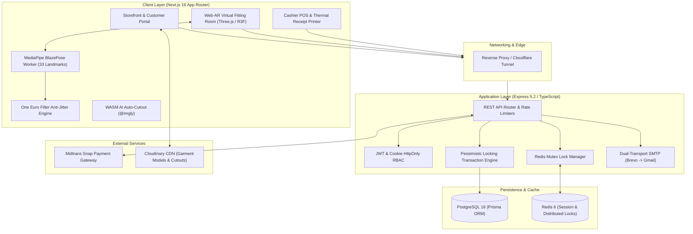

<div align="center">

# 👗 BellsGallery

### *Next-Generation Omnichannel Fashion E-Commerce & On-Device Web-AR Virtual Fitting Room*

[](https://github.com/jalona99/BellsGallery/actions/workflows/ci.yml)
[](https://nextjs.org/)
[](https://react.dev/)
[](https://www.typescriptlang.org/)
[](https://expressjs.com/)
[](https://www.prisma.io/)
[](https://www.postgresql.org/)
[](https://redis.io/)
[](https://threejs.org/)
[](./LICENSE)

<p align="center">
  <b>BellsGallery</b> bridges the gap between digital online convenience and physical retail confidence with an on-device Web-AR Virtual Fitting Room (Web-VFR), AI client-side background removal, enterprise concurrency safeguards, and an integrated in-store Point of Sale (POS) system.
</p>

[Key Features](#-key-capabilities--highlights) •
[Architecture](#-system-architecture) •
[Tech Stack](#-tech-stack) •
[Quick Start](#-quick-start-guide) •
[API Overview](#-api-endpoints-overview) •
[Documentation](#-technical-documentation-suite)

---

</div>

## ✨ Key Capabilities & Highlights

### 1. Dual-Mode Virtual Fitting Room (Web-VFR)
* **Live Web-AR Mode (30+ FPS)**: Real-time 33-point skeletal landmark detection powered by `@mediapipe/tasks-vision` (BlazePose) offloaded to a dedicated Web Worker (`public/pose-worker.js`). Equipped with **One Euro Filter** anti-jitter smoothing and dynamic Euclidean shoulder CAD fitting to adapt garments dynamically to user body proportions.
* **Studio Simulation Mode**: Instant 30 FPS virtual mannequin canvas generator for desktop devices without a physical camera or when webcam permissions are restricted.
* **Photo Try-On HD Mode**: High-definition garment virtual fitting integration powered by Generative AI (CatVTON pipeline).

### 2. In-Browser AI Auto-Cutout Engine
* **Zero-Cost Client-Side Background Removal**: Powered by WebAssembly ONNX segmentation (`@imgly/background-removal`). Generates transparent PNG silhouettes for Web-AR fitting directly inside the administrator's browser in 2–3 seconds—eliminating recurring third-party API costs and GPU server maintenance overhead.

### 3. Omnichannel E-Commerce & In-Store Cashier POS
* **Midtrans Snap Payment Integration**: Real-time payment processing supporting QRIS, GoPay, BCA/Mandiri/BNI Virtual Accounts, and credit cards with HMAC SHA-512 signature verification, replay-attack prevention, and automated rollback upon expiry.
* **In-Store Cashier POS (Point of Sale)**: Dedicated cashier terminal (`POST /api/transactions/cash`) providing atomic stock deduction, instant `PAID` state, barcode/SKU scanning support, and ESC/POS thermal receipt printing (80mm & 58mm).
* **Automated Data Reporting**: Instant CSV/Excel export for sales order logs, transactional histories, and catalog inventories.

### 4. Chaos Defense & High-Concurrency Armor
* **Double-Layered Flash Sale Protection**: Combines atomic **Redis Mutex Distributed Locks** (`lock:checkout:${userId}`) with PostgreSQL **Pessimistic Row Locking** (`SELECT ... FOR UPDATE`) to guarantee absolute zero overselling during extreme traffic spikes.
* **Server-Side Price Validation**: Computes all transaction totals strictly from the database catalog to completely neutralize client-side payload tampering.

### 5. Resilient Dual-Transport Transactional Email
* Meta-styled corporate HTML OTP email notifications powered by primary Brevo SMTP relay (`noreply@bellsgallery.web.id`) featuring automatic, sub-second failover to Google Workspace SMTP in case of upstream relay downtime.

### 6. Unified Administration & RBAC Governance
* Role-Based Access Control (`ADMIN` vs `CUSTOMER`), real-time store KPI analytics (cash vs online revenue, stock depletion warnings, AR readiness ratio), courier tracking (AWB) dispatch management, and protected user lifecycle governance with last-admin safeguards.

---

## 🏛 System Architecture



---

## 🛠 Tech Stack

| Domain | Technology | Key Highlights / Role |
| :--- | :--- | :--- |
| **Frontend** | **Next.js 16.3** (App Router), **React 19.2** | SSR/SSG, Responsive UI, Server Actions, Dynamic Routing |
| **Styling** | **Tailwind CSS v4**, Radix UI, Lucide Icons | Fluid typography, dark/light luxury theme, accessible primitives |
| **3D & Web-AR** | **Three.js r185**, **React Three Fiber**, Drei | Real-time 3D garment rendering, skeletal pinning, material textures |
| **Computer Vision**| **MediaPipe BlazePose 1.0.1** | 33-point body landmark tracking via dedicated background Web Worker |
| **Kinematic Smoothing** | **One Euro Filter** (`OneEuroFilter.ts`) | Dual-cutoff frequency adaptive smoothing for jitter-free live AR fitting |
| **Edge AI Cutout** | **@imgly/background-removal 1.7** | Client-side WebAssembly ONNX neural network segmentation |
| **Backend** | **Express 5.2**, **TypeScript 5.x**, Node.js 20+ | Robust REST architecture, modular controllers, error handling |
| **ORM & Database** | **Prisma 7.9**, **PostgreSQL 16+** | Type-safe queries, migration locks, pessimistic row locking |
| **Distributed Cache**| **Redis 6.2+** (`ioredis`) | Mutex concurrency locking, token blacklisting, caching |
| **Payments** | **Midtrans Snap API** | SHA-512 signature check, webhook callbacks, automated expiry |
| **Assets Storage** | **Cloudinary CDN** | Direct unsigned upload presets for products, textures & GLB models |
| **Transactional Mail**| **Nodemailer**, Brevo Relay & Gmail SMTP | HTML OTP templates, sub-second auto-fallback mechanism |
| **DevOps** | **Docker**, Docker Compose, GitHub Actions | Multi-container orchestration, automated CI lint and typecheck |

---

## 🚀 Quick Start Guide

### 1. Prerequisites
- **Node.js** `20.x` or higher
- **Docker & Docker Compose** (or local PostgreSQL `5435` & Redis `6379`)
- **Git**

### 2. Clone Repository
```bash
git clone https://github.com/jalona99/BellsGallery.git
cd BellsGallery
```

### 3. Start Database & Redis (Docker Compose)
```bash
docker compose up -d
```
*Spins up PostgreSQL on port `5435` and Redis on port `6379`.*

### 4. Backend Setup
```bash
cd backend
npm install

# Copy environment configuration
cp .env.example .env

# Run Prisma migrations & seed database
npx prisma generate
npx prisma db push
npm run dev
```
*Backend runs on `http://localhost:3001`.*

### 5. Frontend Setup
```bash
cd ../frontend
npm install

# Copy environment configuration
cp .env.example .env.local

# Run Next.js in development mode
npm run dev
```
*Frontend runs on `http://localhost:3000`.*

### 6. Testing Mobile Web-AR (Over HTTPS)
Modern browsers require a secure HTTPS context to grant camera permissions:
```bash
# In the project root (using start-tunnel script or cloudflared)
.\start-tunnel.ps1
```
Scan or open the generated `https://*.trycloudflare.com` URL on your iOS or Android smartphone.

---

## 📂 Project Directory Structure

```plaintext
BellsGallery/
├── .github/
│   ├── workflows/ci.yml         # GitHub Actions automated lint & typecheck
│   └── pull_request_template.md # Standardized PR submission template
├── backend/
│   ├── prisma/
│   │   ├── migrations/          # Version-controlled DB schema migrations
│   │   └── schema.prisma        # PostgreSQL entity relational model
│   ├── src/
│   │   ├── config/              # Prisma, Redis, Midtrans client initializers
│   │   ├── controllers/         # Admin, Auth, Product, POS, Transaction logic
│   │   ├── middlewares/         # JWT RBAC auth, Rate limiter, input validation
│   │   ├── routes/              # Modular Express routing endpoints
│   │   ├── scripts/             # Admin provisioning, email test & tunnel runner
│   │   └── utils/               # Dual SMTP failover, HTML email templates
│   ├── Dockerfile
│   └── package.json
├── frontend/
│   ├── public/
│   │   ├── models/              # 3D GLB Garment models (tshirt, shirt)
│   │   ├── products/            # Garment texture maps & normal textures
│   │   └── pose-worker.js       # Background Web Worker for MediaPipe detection
│   ├── src/
│   │   ├── app/                 # Next.js 16 App Router pages
│   │   │   ├── admin/           # Admin Dashboard, Catalog, POS & Analytics
│   │   │   ├── orders/          # Customer order histories & courier tracking
│   │   │   ├── product/[id]/    # Product detail & Web-VFR integration
│   │   │   ├── profile/         # User profile, shipping address & wishlist
│   │   │   └── try-on/          # Standalone Virtual Fitting Studio
│   │   ├── components/          # VirtualFittingRoom, Three.js Garment3D, Header, POS
│   │   ├── context/             # React Cart Context & Authentication State
│   │   └── lib/                 # OneEuroFilter, ProceduralGarment, AI Auto-Cutout
│   ├── Dockerfile
│   └── package.json
├── docs/                        # Comprehensive technical documentation & PRD suite
├── docker-compose.yml           # Multi-container orchestration (DB, Cache)
├── CONTRIBUTING.md              # Open source contribution guidelines
├── LICENSE                      # MIT Open Source License
└── README.md                    # Master Project Documentation
```

---

## 📡 API Endpoints Overview

| Method | Endpoint | Access | Description |
| :--- | :--- | :--- | :--- |
| `POST` | `/api/auth/register` | Public | Register customer account with email OTP verification |
| `POST` | `/api/auth/login` | Public | Authenticate user & issue HttpOnly JWT cookie |
| `POST` | `/api/auth/google` | Public | Google OAuth2 single-sign-on token validation |
| `POST` | `/api/auth/forgot-password` | Public | Dispatch password reset OTP via resilient SMTP |
| `GET`  | `/api/products` | Public | Paginated catalog list with search, categories & sort |
| `GET`  | `/api/products/:id` | Public | Detailed product specs, sizes, stock & AR assets |
| `POST` | `/api/transactions/checkout` | Customer | High-concurrency checkout protected by Redis Mutex & Midtrans |
| `POST` | `/api/transactions/cash` | Admin | In-store cashier POS atomic sale with thermal receipt data |
| `POST` | `/api/transactions/notification` | Webhook | Midtrans webhook signature verification & order status update |
| `GET`  | `/api/admin/analytics` | Admin | Real-time analytics: revenue (cash vs online), stock warnings, AR ratio |
| `POST` | `/api/admin/export/orders` | Admin | Instant CSV export of order logs with date filters |
| `PATCH`| `/api/users/:id/role` | Admin | Update user roles with last-admin deletion protection |

---

## 📚 Technical Documentation Suite

For deeper architectural breakdowns, refer to the documentation suite in [`docs/`](./docs):

- **[Master Technical Reference & Database Schema](./docs/DOCUMENTATION.md)**: Exhaustive schema definition, security policies, and Web-VFR kinematic pipelines.
- **[System Architecture & Omnichannel PRD](./ProjectSpecification.md)**: Product Requirements Document, business economics, and omnichannel workflows.
- **[Deep Audit & Omnichannel Readiness Report](./docs/DEEP_AUDIT_AND_SYSTEM_READINESS_REPORT.md)**: Comprehensive blind audit report validating production stability across all modules.
- **[Admin Operations & Email Security Guide](./docs/ADMIN_CATALOG_AND_EMAIL_SECURITY.md)**: POS thermal printing, CSV exports, RBAC governance, and dual-transport SMTP setup.
- **[AI Auto-Cutout & 3D Garment Pipeline](./docs/AI_AUTO_CUTOUT_AND_GARMENT_WORKFLOW.md)**: In-browser WebAssembly background removal and CAD shoulder alignment.
- **[Chaos Engineering & Payment Resilience](./docs/CHAOS_AND_SECURITY_PAYMENT_SPEC.md)**: Flash-sale concurrency stress defense, Red Team threat modeling, and payment idempotency.
- **[Project Roadmap & Milestones](./ROADMAP.md)**: Engineering timeline, completed sprints, and upcoming v2.0 releases.

---

## 📄 License

This project is licensed under the **MIT License** — see the [LICENSE](./LICENSE) file for details.

---

<div align="center">
  <b>BellsGallery</b> — Designed & Developed by <b>Jabar Arya Lokananta</b><br>
  Universiti Teknologi Malaysia (UTM) • 2026
</div>
