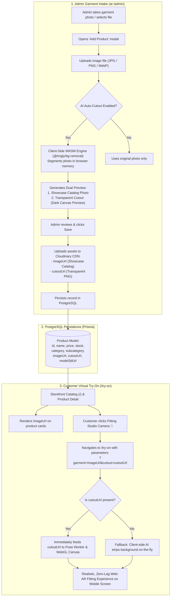

# Architecture & Workflow: AI Auto-Cutout & Virtual Try-On Pipeline

**Document Version:** 2.1 | **Status:** Active Production Specification | **Language:** English

This document defines the technical architecture, data pipeline, and operational workflow for the **In-Browser AI Auto-Cutout Engine** on the **Phygital Store** platform.

This architecture ensures the system is enterprise-ready for public retail launch (*Go-Public*), empowering administrators to upload standard garment photography from any mobile camera or desktop file, and automatically extract high-fidelity transparent PNG silhouettes for the **Web-AR Virtual Fitting Room** at zero infrastructure cost.

---

## 1. Background & Problem Statement

### A. The Dual Visual Asset Requirement
In omnichannel phygital commerce, every garment requires two distinct visual assets:
1. **Showcase Catalog Image (`imageUrl`)**:
   - Rendered on the public storefront, search results, and product detail pages.
   - Shows the garment with professional backgrounds, hangers, or modeled photography.
2. **Transparent Silhouette Cutout (`cutoutUrl`)**:
   - Loaded exclusively when a shopper activates the **Fitting Studio (Web-AR Try-On)**.
   - Must be an alpha-channel **transparent PNG** without background pixels, allowing the computer vision engine to warp and align the garment naturally along the user's shoulders and torso without clipping square white boxes over the camera feed.

### B. Legacy Bottlenecks & Evolution
* **Static File Hardcoding**: Early iterations relied on rigid filename matching (e.g., `kaos-kuning-77-cutout.png`), blocking dynamic additions of new garments.
* **External Server Dependency**: Previous experimental scripts attempted background removal using a local Python/Flask server. If the script was inactive, uploaded garments displayed as opaque rectangular stickers over the webcam.
* **Cloud API Cost Overhead**: Commercial AI background removal APIs (e.g., Cloudinary `e_background_removal`, Remove.bg) charge recurring per-image fees ($0.05–$0.20 per photo), generating avoidable operational costs.

### C. Implemented Solution: Client-Side WebAssembly Engine
We implemented client-side image segmentation powered by **WebAssembly (WASM)** and ONNX runtime via `@imgly/background-removal`.
- Background removal executes directly in the administrator's web browser using client CPU/GPU resources.
- **Infrastructure Cost: $0.00 (100% Free)**.
- Zero server-side Python dependencies.
- Zero Cloudinary AI credits consumed.

---

## 2. End-to-End System Workflow



---

## 3. Component Architecture & Code Implementation

### A. Database Schema (`backend/prisma/schema.prisma`)
The `Product` table stores the optional transparent asset link `cutoutUrl`:
```prisma
model Product {
  id               String            @id @default(uuid())
  name             String
  description      String
  price            Float
  imageUrl         String
  cutoutUrl        String?           // Transparent PNG asset for Web-AR Try-On
  model3dUrl       String?
  category         String            @default("pria")
  subcategory      String            @default("kaos")
  createdAt        DateTime          @default(now())
  updatedAt        DateTime          @updatedAt
  inventory        Inventory?
  transactionItems TransactionItem[]
  wishlists        Wishlist[]

  @@index([category, subcategory])
}
```

### B. Backend REST Endpoints (`backend/src/routes/product.routes.ts`)
* `POST /api/products`: Validates and saves incoming `cutoutUrl` into PostgreSQL.
* `PUT /api/products/:id`: Updates `cutoutUrl` when existing products are modified.

### C. Client-Side Segmentation Engine (`frontend/src/lib/autoCutout.ts`)
```typescript
import { removeBackground } from "@imgly/background-removal";

export async function generateGarmentCutout(imageSource: string | File | Blob): Promise<Blob> {
  const blob = await removeBackground(imageSource, {
    progress: (key, current, total) => {
      // Optional loading progress tracking
    },
    output: {
      format: "image/png",
      quality: 0.95
    }
  });
  return blob;
}
```

### D. Real-Time Try-On Consumption (`ProductCard.tsx` & `try-on/page.tsx`)
1. **Catalog Linkage**:
   When launching the fitting room, `ProductCard.tsx` checks for `product.cutoutUrl` and encodes both `garment` and `cutout` query parameters:
   ```typescript
   const tryOnUrl = `/try-on?garment=${encodeURIComponent(product.imageUrl)}&cutout=${encodeURIComponent(product.cutoutUrl || '')}`;
   ```
2. **Pose Worker Tracking**:
   In `try-on/page.tsx`, the pose tracking loop maps the transparent cutout texture over the user's shoulders and torso using Euclidean CAD landmark coordinates (Left Shoulder 11, Right Shoulder 12) rendered at 30+ FPS.

### E. Customer Custom Garment Intake & Lifecycle (`ARPanel.tsx` & `tryon-store.ts`)
1. **In-Studio Gallery Upload**:
   Shoppers can upload custom clothing photos directly from their phone/PC gallery in `ARPanel.tsx`. The in-browser WebAssembly engine (`removeImageBackground`) segments the background in 2–3s and mounts the transparent silhouette onto the user's body in the live AR feed.
2. **Garment List Deletion & History Cleanup**:
   Every custom or previously worn garment in the studio switcher includes a dedicated delete button (`Trash2`). Users can also purge all tried-on history at once via "Hapus Riwayat", preventing UI clutter and eliminating unbounded `localStorage` growth.
3. **Client-Side Heuristic Classification (`heuristicGarmentType`)**:
   Eliminates all dependencies on legacy port 5000 Python/Flask servers. Evaluates filenames and keywords (`kaos`, `celana`, `dress`) client-side to automatically preselect the fitting category (*upper*, *lower*, *full*) with 85% confidence.

---

## 4. Key Performance & Financial Metrics

| Metric | Cloud API Approach (e.g., Cloudinary AI) | In-Browser WASM Engine (`@imgly`) |
|---|---|---|
| **Cost per 1,000 Garments** | ~$50.00 – $200.00 recurring | **$0.00 (Zero)** |
| **Backend Server Load** | Medium (Webhook & file proxying) | **Zero (Processed in browser)** |
| **Processing Speed** | 4–8 seconds (Network roundtrips) | **2–3 seconds (Local WASM computation)** |
| **Data Privacy** | Images sent to external third parties | **100% On-Device execution** |
