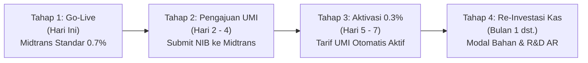

# Business Plan: Omnichannel Economics & Profit Retention
## Phygital Store — Strategi Pembayaran, Unit Economics, dan Alokasi Modal Bebas "Bakar Duit"

**Dokumen Versi:** 1.0  
**Tanggal:** 11 Oktober 2026  
**Status:** Disetujui & Terintegrasi dengan Arsitektur Produksi  
**Target Platform:** Phygital Store (Website D2C Web-AR & Toko Fisik)

---

## 1. Ringkasan Eksekutif (Executive Summary)

**Phygital Store** mengusung model bisnis ritel fesyen modern yang memadukan toko digital (Direct-to-Consumer / D2C) dengan pengalaman toko fisik melalui inovasi **Web-AR Virtual Fitting Room (Web-VFR)**.

Tujuan utama rencana bisnis ini adalah **memaksimalkan laba bersih yang ditahan (Retained Earnings) dan kesehatan arus kas (Cash Flow)** dengan memangkas kebocoran biaya transaksi pembayaran. Dengan membandingkan tiga kanal pembayaran utama:
1. **Shopee Marketplace** (Potongan platform ~13.6%)
2. **QRIS Midtrans Standar** (Potongan gateway 0.7%)
3. **QRIS Usaha Mikro / UMI BI via Midtrans** (Potongan regulasi Bank Indonesia 0.3%)

### Prinsip Utama: Anti "Bakar Duit" (Zero Promo/Discount Policy)
Rencana bisnis ini **secara tegas menolak** penggunaan penghematan biaya transaksi untuk perang diskon, kupon promo, atau subsidi gratis ongkir mandiri yang bersifat mengikis margin. Seluruh penghematan (mencapai **Rp 26.650 per potong baju** atau **Rp 13–26+ Juta per bulan**) dialokasikan 100% untuk **penguatan fundamental bisnis**: perputaran modal kerja, bahan baku premium, riset teknologi AR, dan cadangan kas operasional yang kokoh.

---

## 2. Analisis Unit Economics (Penjualan Produk Rp 200.000)

Studi kasus didasarkan pada harga jual 1 pcs produk fesyen standar: **Rp 200.000**.  
Asumsi Biaya Pokok Penjualan / HPP (Bahan kain katun combed premium 24s/16s, sablon/bordir, tenaga jahit): **Rp 70.000 (35%)**.

### 2.1. Tabel Komparasi Unit Economics Per Pcs

| Parameter Keuangan | Shopee Marketplace | QRIS Midtrans Standar | QRIS Usaha Mikro (UMI) |
| :--- | :--- | :--- | :--- |
| **Harga Jual ke Konsumen (Nett)** | Rp 200.000 | Rp 200.000 | Rp 200.000 |
| **Skema Biaya / Fee** | Biaya Admin + Layanan (~13.625%) | MDR Payment Gateway (0.7%) | MDR Resmi BI Usaha Mikro (0.3%) |
| **Nominal Potongan Transaksi** | **Rp 27.250** | **Rp 1.400** | **Rp 600** |
| **Dana Bersih Diterima (Net Cash)** | **Rp 172.750** | **Rp 198.600** | **Rp 199.400** |
| **HPP Produk** | Rp 70.000 | Rp 70.000 | Rp 70.000 |
| **Laba Kotor (Gross Profit)** | **Rp 102.750** | **Rp 128.600** | **Rp 129.400** |
| **Gross Margin (%)** | **51.38%** | **64.30%** | **64.70%** |
| **Keuntungan Tambahan vs Shopee** | *Baseline* | **+ Rp 25.850 / pcs** | **+ Rp 26.650 / pcs** |

> **Catatan Finansial:**  
> Penjualan melalui website sendiri via QRIS UMI menghasilkan kas bersih **Rp 26.650 lebih banyak per potong pakaian** dibandingkan jika terjual melalui marketplace Shopee.

---

## 3. Simulasi Skalabilitas Finansial Bulanan

Berikut adalah proyeksi kumulatif biaya platform dan potensi kebocoran dana berdasarkan volume penjualan:

| Volume Bulanan | Omzet Kotor (GMV) | Beban Shopee (13.6%) | Beban Midtrans Standar (0.7%) | Beban QRIS UMI (0.3%) | **Kas Bersih yang Diselamatkan (UMI vs Shopee)** |
| :---: | :---: | :---: | :---: | :---: | :---: |
| **50 Pcs** | Rp 10.000.000 | Rp 1.362.500 | Rp 70.000 | Rp 30.000 | **Rp 1.332.500** |
| **100 Pcs** | Rp 20.000.000 | Rp 2.725.000 | Rp 140.000 | Rp 60.000 | **Rp 2.665.000** |
| **300 Pcs** | Rp 60.000.000 | Rp 8.175.000 | Rp 420.000 | Rp 180.000 | **Rp 7.995.000** |
| **500 Pcs** | Rp 100.000.000 | Rp 13.625.000 | Rp 700.000 | Rp 300.000 | **Rp 13.325.000** |
| **1.000 Pcs** | Rp 200.000.000 | Rp 27.250.000 | Rp 1.400.000 | Rp 600.000 | **Rp 26.650.000** |

Pada skala 500 pcs/bulan, bisnis menyelamatkan **Rp 13.325.000 per bulan** (atau **Rp 159.900.000 per tahun**) kas riil yang sebelumnya lenyap menjadi biaya administrasi marketplace.

---

## 4. Strategi Alokasi Penghematan: 100% Penguatan Fundamental (Zero Burn Rate)

Alih-alih membuang penghematan belasan juta rupiah untuk promo sesaat, diskon, atau voucher, dana penghematan dialokasikan ke dalam **4 Pilar Produktif**:

```
┌─────────────────────────────────────────────────────────────────────────────┐
│                    ALOKASI PENGHEMATAN BIAYA TRANSAKSI                      │
│               (Total Kas Diselamatkan: Rp 13 - 26+ Juta / Bulan)             │
├─────────────────────────────────────────────────────────────────────────────┤
│                                                                             │
│  [40%] Modal Kerja & Produksi        ──▶ Restock kain grade-A tanpa utang  │
│  [25%] Cadangan Kas Operasional      ──▶ Emergency fund & laba ditahan     │
│  [20%] Infrastruktur Teknologi & R&D ──▶ Server Web-AR, CDN, POS hardware  │
│  [15%] Quality Control & Packaging   ──▶ Box kokoh, polymailer tebal, QC   │
│                                                                             │
└─────────────────────────────────────────────────────────────────────────────┘
```

### 4.1. Pilar 1: Modal Kerja & Produksi (Alokasi: 40% — Rp 5,3 Juta s.d. Rp 10,6 Juta/bulan)
* **Restock Bahan Baku Berkualitas Lebih Cepat:** Menghindari stok kosong (*out-of-stock*) pada model pakaian unggulan.
* **Volume Purchasing Advantage:** Kas riil memungkinkan pembelian gulungan kain (*roll*) dalam jumlah lebih besar langsung dari pabrik tekstil, menurunkan HPP dari Rp 70.000 menjadi Rp 62.000 – Rp 65.000 per pcs.
* **Tanpa Bunga Pinjaman Bank/Fintech:** Memperbesar perputaran siklus operasional tanpa beban modal eksternal.

### 4.2. Pilar 2: Cadangan Kas & Laba Ditahan / Retained Earnings (Alokasi: 25% — Rp 3,3 Juta s.d. Rp 6,6 Juta/bulan)
* Membangun dana darurat operasional bisnis setara 3–6 bulan biaya operasional (*runway*).
* Memperkuat neraca keuangan (*Balance Sheet*) perusahaan sehingga memiliki nilai valuasi aset nyata yang sehat.

### 4.3. Pilar 3: Infrastruktur Teknologi & R&D Phygital (Alokasi: 20% — Rp 2,6 Juta s.d. Rp 5,3 Juta/bulan)
* **Kestabilan Server & CDN:** Menjamin server Next.js dan backend PostgreSQL beroperasi dengan latensi < 100ms di seluruh Indonesia.
* **Optimasi Pipeline Web-AR:** Pengembangan berkelanjutan model MediaPipe Pose Detection dan 3D drape fitting agar kompatibel dengan perangkat Android/iOS spek rendah.
* **Perangkat POS Toko Fisik:** Pemeliharaan scanner barcode, tablet kasir, dan thermal printer untuk operasional offline store yang tersinkronisasi realtime dengan database.

### 4.4. Pilar 4: Packaging & Quality Control (Alokasi: 15% — Rp 2,0 Juta s.d. Rp 4,0 Juta/bulan)
* **Pengemasan Fisik Premium Tahan Cuaca:** Menggunakan box karton tebal berpita segel keamanan dan plastik biodegradable tahan air. Ini melindungi pakaian dari kerusakan ekspedisi tanpa memotong margin produk.
* **Inspeksi Kualitas Ganda (Double QC):** Memastikan jahitan, kancing, dan ukuran 100% presisi sebelum dikirim, menjaga tingkat retur pakaian tetap di bawah < 5%.

---

## 5. Strategi Kanal (Omnichannel Channel Matrix)

| Dimensi | Shopee Marketplace | Website D2C (Midtrans Standar) | Website D2C (QRIS UMI) |
| :--- | :--- | :--- | :--- |
| **Peran Strategis** | Top of Funnel (Discovery) | Transisi & Launching Cepat | Mesin Utama Margin & Loyalitas |
| **Kebijakan Harga** | **Rp 215.000** (Markup +7.5% untuk kompensasi fee) | **Rp 200.000** (Harga Resmi Toko) | **Rp 200.000** (Harga Resmi Toko) |
| **Nilai Tambah Konsumen** | Kemudahan pembayaran marketplace | Pengalaman Web-AR Virtual Try-On | Pengalaman Web-AR Virtual Try-On |
| **Dukungan POS Fisik** | Tidak ada | Terintegrasi POS database | Terintegrasi POS database |
| **Arus Kas Masuk** | H+2 s.d. H+7 setelah barang diterima | H+1 s.d. H+2 langsung ke rekening | H+1 s.d. H+2 langsung ke rekening |

### Mekanisme Migrasi Organik (Tanpa Diskon):
1. Pelanggan baru menemukan produk di Shopee karena algoritma pencarian.
2. Di dalam paket pakaian yang dikirim dari Shopee, diselipkan brosur informasi produk:
   > *"Ingin tahu ukuran baju yang paling pas sebelum membeli model berikutnya? Kunjungi toko resmi kami di www.phygitalstore.com — Coba pakaian secara instan lewat kamera HP Anda dengan fitur Virtual Fitting Room."*
3. Konsumen beralih ke website pada transaksi berikutnya karena **fitur teknologi AR dan kepastian ukuran**, bukan karena iming-iming diskon murah.

---

## 6. Verifikasi Kondisi Teknis Project Saat Ini

Pemeriksaan menyeluruh terhadap repository lokal `phygital-store`:

```
backend/
├── src/
│   ├── config/
│   │   └── midtrans.ts           <-- [OK] Snap & CoreApi Client Siap
│   ├── controllers/
│   │   └── transactionController.ts <-- [OK] Endpoint checkout, Snap token, webhook SHA-512
│   └── routes/
│       └── transaction.routes.ts <-- [OK] Routing aktif
├── .env                          <-- [OK] MIDTRANS_SERVER_KEY & MIDTRANS_CLIENT_KEY Mode Production aktif!
frontend/
├── src/
│   ├── app/
│   │   └── layout.tsx            <-- [OK] Snap.js script production terpasang
│   └── components/
│       └── Header.tsx            <-- [OK] Integrasi popup snap.pay()
```

### Kesimpulan Verifikasi:
1. **QRIS Midtrans Standar (0.7%):**
   * **BISA DIGUNAKAN DETIK INI JUGA.**
   * Seluruh pipeline kode (Frontend, Backend, Database PostgreSQL, Redis Lock) sudah selesai diuji dan siap menerima pembayaran real.
2. **QRIS Usaha Mikro / UMI (0.3%):**
   * **KOMPATIBEL 100% DENGAN KODE SAAT INI.**
   * Tidak ada refactoring atau perubahan skrip yang dibutuhkan di backend maupun frontend.
   * Cukup satu langkah administratif: verifikasi status UMI di dashboard Midtrans.

---

## 7. Rencana Aksi (Action Roadmap)



### Tahap 1: Go-Live Operasional Langsung (Hari ke-1)
* Menggunakan integrasi Midtrans yang sudah ada di codebase.
* Website menerima pesanan online dan transaksi POS fisik dengan QRIS Midtrans Standar (0.7% = Rp 1.400).
* Seluruh pencatatan transaksi masuk ke tabel `Transaction` di PostgreSQL.

### Tahap 2: Pengajuan Status Usaha Mikro (Hari ke-2 s.d. 4)
* **Dokumen yang Disiapkan:**
  1. KTP Pemilik Usaha
  2. NPWP (Perseorangan / Badan)
  3. NIB (Nomor Induk Berusaha) kategori Usaha Mikro melalui [OSS Indonesia](https://oss.go.id). (Pendaftaran gratis, terbit otomatis dalam 15–30 menit).
* **Langkah Pengajuan:**
  * Buka tiket bantuan di Dashboard Midtrans (`support@midtrans.com` atau menu *Contact Us*).
  * Subjek: `Permohonan Penetapan Kategori QRIS Usaha Mikro (UMI) - Merchant ID: [Merchant ID]`.
  * Lampirkan file PDF NIB.

### Tahap 3: Pemantauan Penurunan Tarif (Hari ke-5 s.d. 7)
* Midtrans melakukan verifikasi data bersama Bank Indonesia dan lembaga switching (ASPI/NSP).
* Setelah disetujui, Midtrans mengirimkan konfirmasi bahwa MDR QRIS telah disesuaikan menjadi **0.3%**.
* Lakukan 1 transaksi uji coba untuk memverifikasi settlement report menunjukkan potongan fee sebesar Rp 600 untuk transaksi Rp 200.000.

### Tahap 4: Alokasi Kas Produktif & Ekspansi Stabil (Bulan ke-1 dst.)
* Rekonsiliasi bulanan mencatat total efisiensi biaya.
* Salurkan seluruh penghematan ke dalam rekening terpisah untuk **Restock Bahan Baku Berkualitas** dan **Pemeliharaan Infrastruktur Server/AR**, tanpa alokasi voucher bakar duit.

---

## 8. Analisis Risiko & Mitigasi Tata Kelola

| Risiko | Dampak | Strategi Mitigasi |
| :--- | :--- | :--- |
| **Limit Transaksi QRIS UMI** | Transaksi > Rp 10.000.000/transaksi tidak dapat diproses via QRIS reguler | Keranjang belanja retail rata-rata Rp 200.000 – Rp 1.500.000 (jauh di bawah batas plafon BI Rp 10 Juta per transaksi). |
| **Fluktuasi Kunjungan Website** | Penjualan online sepi di awal peluncuran | Manfaatkan Shopee sebagai kanal etalase awal dengan harga markup untuk menyerap biaya, lalu tarik pembeli ke website melalui keunggulan fitting Web-AR. |
| **Ketergantungan Ekosistem Gateway** | Gangguan konektivitas Midtrans | Mekanisme *Circuit Breaker* (timeout 8 detik) yang sudah terpasang di `transactionController.ts` mencegah server hang jika terjadi keterlambatan gateway. |

---

*Dokumen ini merupakan panduan strategis operasional resmi untuk Phygital Store. Dilarang mengalihkan alokasi penghematan biaya transaksi ke skema bakar duit atau subsidi harga tanpa persetujuan manajemen.*
