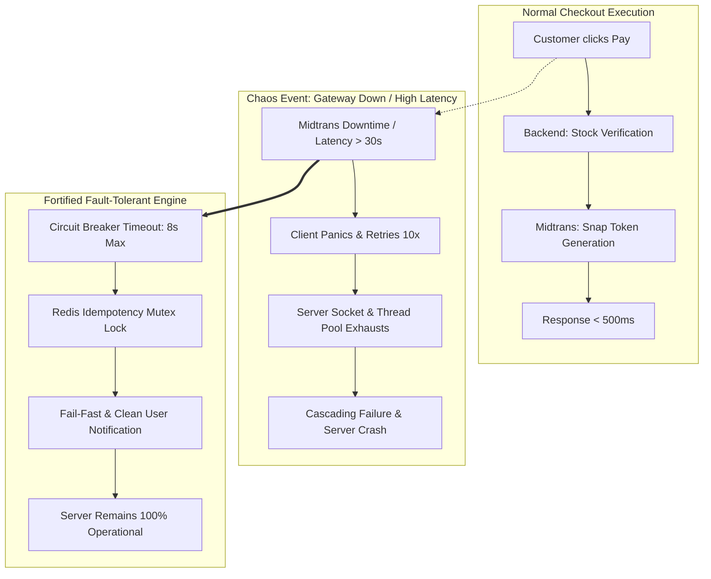
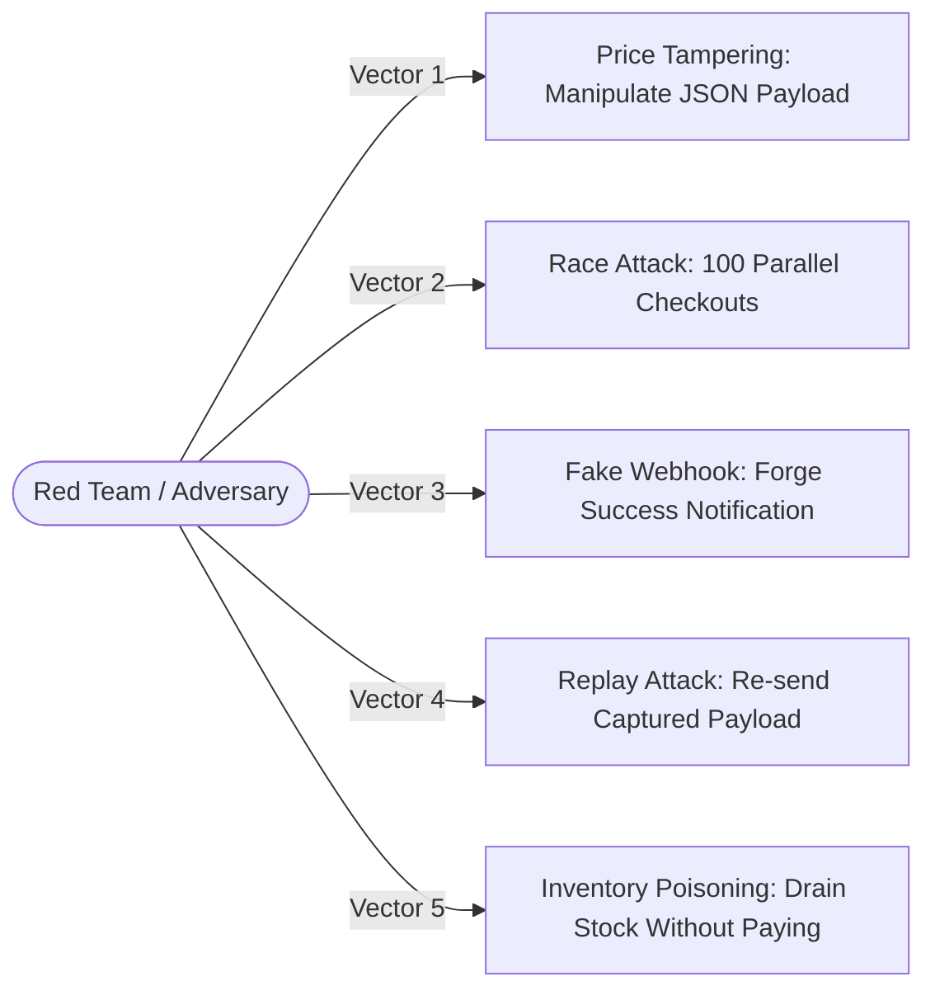
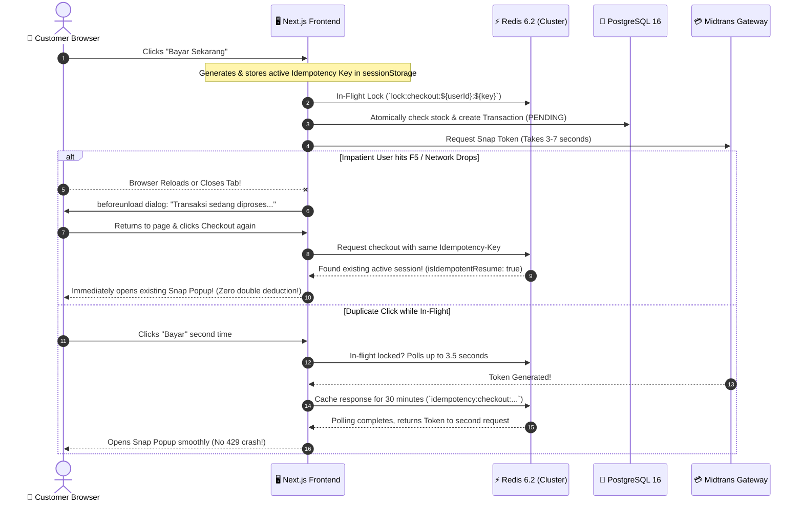

# Chaos Engineering & Payment Security Specification (Red Team Defense)

**Document Version:** 2.3 | **Status:** Master Security Benchmark | **Language:** English

This specification documents the cybersecurity hardening, **Chaos Engineering** failure resilience, and **Red Team** adversarial threat mitigations engineered into the **Phygital Store** payment and inventory processing pipeline.

---

## 1. Executive Summary & Vulnerability Audit

Payment processing and inventory reservation represent the highest-risk domains in modern e-commerce. A comprehensive security audit identified seven critical vulnerability vectors that have been systematically fortified in the codebase:

| Vulnerability Vector | Pre-Hardened State | Fortified Production State |
| :--- | :--- | :--- |
| **Price Tampering** | ❌ **CRITICAL**: Total calculated from client payload `req.body.items[i].price`. Adversaries could buy garments for Rp 1. | 🛡️ **HARDENED**: Client prices are strictly ignored. Official prices are fetched directly from the PostgreSQL `Product` table. |
| **Double-Click / Race Attack** | ❌ Concurrent clicks by users or automated bots caused duplicate checkout billing and inventory race conditions. | 🛡️ **HARDENED**: Protected by **Redis Mutex Locks** (`lock:checkout:${userId}`) and PostgreSQL **Pessimistic Locking** (`SELECT ... FOR UPDATE`). |
| **Payment Gateway Timeout** | ❌ Gateway latencies caused server socket pools to exhaust, triggering retry storms and cascading server crashes. | 🛡️ **HARDENED**: **Fail-Fast Circuit Breaker (8-second timeout)** with isolated non-blocking error responses. |
| **Webhook Replay Attack** | ❌ Duplicate webhook deliveries re-executed order status updates and risked corrupting inventory balances. | 🛡️ **HARDENED**: **Idempotency State Check** prior to executing `PAID` state transitions, with guarded stock rollback on `FAILED`. |
| **Fake Webhook Injection** | ❌ Attackers could spoof payment notifications to mark unfulfilled orders as paid. | 🛡️ **HARDENED**: Cryptographic **SHA-512 Signature Verification** validating gateway authenticity. |
| **Multi-Variant Collision & Gateway Duplicate ID** | ❌ Multiple variants of identical product (e.g., Color Wine/Size S vs Color Gray/Size M) shared generic `productId`, causing frontend bulk-deletion and Midtrans 400 rejection on duplicate item IDs. | 🛡️ **HARDENED**: Enforced unique composite keys (`cartItemId`) on frontend and index-suffixed identifiers (`${productId}-${idx+1}`) in Midtrans Snap payloads while strictly maintaining relational foreign-key integrity in PostgreSQL. |
| **Network Lag & Accidental Refresh Idempotency Desync** | ❌ Slow network connections or impatient client F5-refresh caused duplicate pending orders, locked inventory, and double-charges. | 🛡️ **HARDENED**: **Enterprise-grade Idempotency Engine**: `Idempotency-Key` headers + Redis 30m Session Cache (`isIdempotentResume`) + In-Flight Smart Polling (3.5s) + `beforeunload` browser safeguard + PostgreSQL 15m fallback matcher. |

---

## 2. Chaos Engineering Failure Modes

Chaos Engineering verifies systemic stability under third-party dependency outages and adverse network conditions.



### Chaos Test Matrices

#### Scenario A: Gateway Latency Spike / Hard Downtime (> 30 Seconds)
* **Chaos Condition:** Payment gateway experiences high latency or total network unresponsiveness.
* **System Risk:** Node.js exhausts socket pools, memory bloats under queued requests, leading to server unresponsiveness.
* **Implemented Mitigation:**
  The `withTimeout(snap.createTransaction(...), 8000)` circuit breaker enforces an 8-second execution cap, cleanly returning an HTTP 504 error without stranding server resources.

#### Scenario B: Webhook Network Partition (Dropped Delivery)
* **Chaos Condition:** Shopper transfers funds successfully via bank/QRIS, but HTTP webhook notification packets from the gateway fail to reach the store backend due to a temporary internet partition.
* **System Risk:** Orders remain in `PENDING` status indefinitely despite successful customer payment.
* **Recommended Mitigation:**
  Scheduled reconciliation cron jobs periodically query gateway status (`GET /v2/{order_id}/status`) for pending transactions older than 10 minutes.

---

## 3. Red Team Attack Vectors & Defense Mechanics



### 1. Vector 1: Price Tampering (Client Payload Manipulation)
* **Attack Method:**
  An adversary intercepts the `POST /api/transactions/checkout` request using an HTTP proxy (e.g., OWASP ZAP or Burp Suite) and alters the price from Rp 149,000 to Rp 1.
* **Implemented Defense:**
  In `transactionController.ts`, client-provided item prices are ignored. The server queries verified database prices:
  ```typescript
  const officialProduct = productMap.get(item.productId);
  const verifiedPrice = officialProduct.price; // Official database price
  totalAmount += verifiedPrice * item.quantity;
  ```

### 2. Vector 2: Race Condition / Double-Spending on Limited Inventory
* **Attack Method:**
  An adversary executes 50 parallel automated checkout requests within the same millisecond targeting a garment with only 1 item remaining in stock.
* **Implemented Defense:**
  1. **Redis Atomic Mutex Lock**: Blocks consecutive requests from the same user within 5 seconds (`lock:checkout:${userId}`).
  2. **PostgreSQL Pessimistic Row Locking**:
     ```sql
     SELECT stock FROM "Inventory" WHERE "productId" = $1 FOR UPDATE
     ```
     Locks the database row exclusively. If `stock < quantity`, the transaction rolls back immediately with zero overselling.

### 3. Vector 3: Fake Webhook Injection (Payment Spoofing)
* **Attack Method:**
  An adversary crafts an HTTP POST request to `/api/transactions/webhook` with `transaction_status: "settlement"` targeting their own pending order ID.
* **Implemented Defense:**
  The server computes an expected SHA-512 cryptographic hash:
  ```typescript
  const expectedSignature = crypto
    .createHash("sha512")
    .update(`${order_id}${status_code}${gross_amount}${serverKey}`)
    .digest("hex");

  if (signature_key !== expectedSignature) {
    return res.status(400).json({ error: "Invalid signature" });
  }
  ```
  Unauthenticated webhook payloads are rejected with HTTP 400.

### 4. Vector 4: Webhook Replay Attack
* **Attack Method:**
  An attacker intercepts a legitimate payment notification and replays it multiple times to trigger unintended side-effects.
* **Implemented Defense:**
  The handler inspects current transaction status:
  ```typescript
  if (existingTransaction.status === "PAID") {
    return res.status(200).json({ message: "Already processed" });
  }
  ```
  Duplicate notifications return HTTP 200 idempotently without duplicate processing.

### 5. Vector 5: Inventory Poisoning & DoS via Abandoned Checkouts
* **Attack Method:**
  Adversaries generate dozens of unpaid orders to reserve all available stock and prevent legitimate customers from purchasing.
* **Implemented Defense:**
  - Automated Inventory Rollback: When payment status arrives as `expire`, `cancel`, or `deny`, the backend atomically restores stock back into the `Inventory` table:
  ```typescript
  await prisma.inventory.update({
    where: { productId: item.productId },
    data: { stock: { increment: item.quantity } }
  });
  ```

### 6. Vector 6: Multi-Variant Collision, Inventory Atomicity & Gateway Payload Integrity
* **Vulnerability & Failure Scenario:**
  When customers purchase multiple distinct variants of the same base product (e.g., *Baju santai oblong* in Size S / Wine and Size M / Gray):
  1. **Frontend State Desync:** If identified solely by base `productId`, removing one variant removes all variants simultaneously from the cart, or merging dissimilar variants corrupts user selection.
  2. **Payment Gateway Rejection:** Midtrans Snap API requires `item_details[].id` to be strictly unique across the array. Submitting duplicate `productId`s causes Midtrans to return `400 Bad Request: item_details[x].id is duplicate`, preventing checkout.
  3. **Inventory Race & Underselling Risk:** When multiple line items reference the same `productId`, database locks must serialize properly so inventory is deducted for each item without deadlocking or overselling.
* **Implemented Defense:**
  1. **Client-Side Composite Keys:** Cart items derive a deterministic composite key: `${productId}__sz_${size}__col_${color}`. Operations (`removeFromCart`, `updateQuantity`) target the exact variant without bleed-through.
  2. **Gateway ID Disambiguation:** Before dispatching to Midtrans, `item_details` identifiers are suffixed deterministically with sequential indices (`${item.productId.substring(0, 40)}-${idx + 1}`), guaranteeing array-level uniqueness while staying strictly within Midtrans' 50-character limit.
  3. **Relational Database Integrity:** PostgreSQL `TransactionItem` records retain the canonical `productId` foreign key to `Product.id`.
  4. **Pessimistic Sequential Stock Decrements:** In PostgreSQL transaction block, row locks (`SELECT ... FOR UPDATE`) are held while each variant decrements stock sequentially. If the aggregate requested quantity across variants exceeds available stock, the entire transaction rolls back atomically.

---

### 7. Vector 7: Network Latency, Accidental Client Refresh & Multi-Tab Idempotency Desync



* **Vulnerability & Failure Scenario:**
  1. **Network Lag & Impatient Refresh:** When third-party payment gateways take 3–7 seconds to respond, users frequently reload the browser, press the back button, or re-click checkout.
  2. **Phantom Orders & Stock Stranding:** In legacy e-commerce, the first attempt successfully decrements PostgreSQL inventory and creates a `PENDING` transaction. When the reloaded page executes checkout again, it creates a second transaction and decrements inventory a second time. If the garment has only 1 remaining in stock, the second checkout fails with an erroneous *"Out of Stock"* error, leaving the shopper blocked by their own abandoned session.
  3. **Double Billing:** If both Midtrans Snap sessions are subsequently paid by the user, the customer is double-charged.

* **Implemented Multi-Tier Idempotency Defense:**
  1. **Client-Side Sessional Idempotency Key:**
     In `Header.tsx`, when checkout starts, a persistent UUID (`checkout_key_${user.id}`) is established in `sessionStorage` and transmitted in the HTTP request payload and `Idempotency-Key` header.
  2. **Browser `beforeunload` Interceptor:**
     While `isCheckingOut` is true, an active listener warns the user against reloading or closing the tab while payment communication is in progress.
  3. **Redis Sessional Cache (30 Minutes / 1,800s):**
     Completed checkout responses are cached under `idempotency:checkout:${userId}:${idempotencyKey}`. If a duplicate request arrives within 30 minutes:
     - If the order is `PAID`, returns `{ isPaid: true }` immediately.
     - If the order is `PENDING`, returns `{ isIdempotentResume: true, token, paymentUrl }` directly without touching inventory or hitting Midtrans again.
  4. **In-Flight Concurrency Smart Polling:**
     When a duplicate request arrives while the first request is actively in-flight (`in_flight` Redis lock), rather than immediately returning a jarring HTTP 429 error, the second request polls every 500ms (up to 3.5s). Once the primary thread acquires the Midtrans token and caches it, the secondary request inherits the result seamlessly.
  5. **PostgreSQL Relational Fallback Matcher:**
     If Redis experiences a cold start or eviction, the server queries PostgreSQL for any identical `PENDING` orders created within the last 15 minutes by the same customer. If matched, the session is restored into Redis and resumed.
  6. **Fail-Safe Cleanup:**
     A guaranteed `finally` block releases the in-flight mutex lock (`await redisClient.del(lockKey)`), preventing deadlocks under all execution outcomes.


