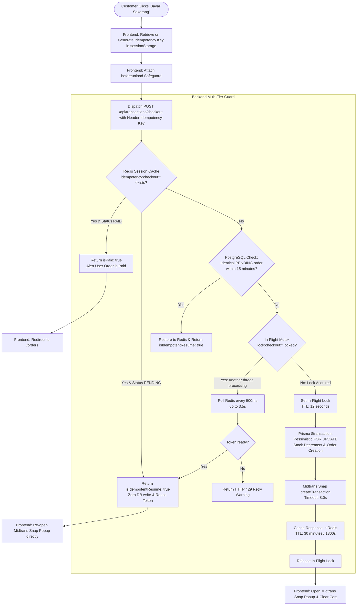

# Payment Idempotency & Network Resilience Technical Specification

**Document Version:** 1.0 | **Last Updated:** October 12, 2026 | **Classification:** Master Architecture Guide

This specification defines the multi-tiered **Idempotency Engine** and **Network Resilience Architecture** implemented in the **Phygital Store** platform. It provides end-to-end documentation on how the system guarantees **zero duplicate orders**, **zero double stock deductions**, and **zero customer lockouts** under poor mobile networks, high-latency payment gateway responses, double-clicks, and accidental page reloads.

---

## 1. Problem Statement & Architecture Objectives

In modern omnichannel and e-commerce platforms, payment gateways (e.g., Midtrans Snap) can experience latencies between 3 and 8 seconds depending on bank processing times, QRIS networks, or cellular connection stability. During this critical window, customers frequently:
1. **Accidentally refresh the page (F5 / mobile swipe)** while the loading spinner is active.
2. **Double-click or rage-click** the checkout button.
3. **Lose internet connection** temporarily and attempt to checkout again upon reconnecting.

### Legacy Failure Modes (Eliminated)
* ❌ **Duplicate Billing:** Creating 2 distinct orders for a single cart checkout.
* ❌ **Inventory Stranding / False "Out of Stock":** Subtracting stock twice in the database. If only 1 unit remained in inventory, the customer's second attempt failed with *"Stok tidak mencukupi"*, effectively blocking the legitimate buyer with their own pending transaction.
* ❌ **Jarring HTTP 429 Errors:** Rebuffing the customer with generic rate-limit errors when they reload, inducing buyer panic.

---

## 2. Multi-Tier Idempotency Lifecycle



---

## 3. Detailed Component Mechanics

### 3.1. Client-Side Idempotency Key Management (`Header.tsx`)
1. **Sessional Key Generation:**
   Before dispatching the checkout request, the frontend inspects `sessionStorage` for `checkout_key_${user.id}`. If absent, it generates a cryptographically random, timestamped key:
   ```typescript
   let activeIdempotencyKey = sessionStorage.getItem(`checkout_key_${user.id}`);
   if (!activeIdempotencyKey) {
     activeIdempotencyKey = `chk_${user.id.substring(0, 8)}_${Date.now()}_${Math.random().toString(36).substring(2, 7)}`;
     sessionStorage.setItem(`checkout_key_${user.id}`, activeIdempotencyKey);
   }
   ```
2. **Dual-Channel Delivery:**
   The key is submitted via both the standard HTTP request header (`Idempotency-Key`) and the JSON request body (`idempotencyKey`).
3. **Accidental Refresh Interceptor (`beforeunload`):**
   While `isCheckingOut` is `true`, an active window listener warns the user if they try to close or reload the browser:
   ```typescript
   const handleBeforeUnload = (e: BeforeUnloadEvent) => {
     e.preventDefault();
     e.returnValue = 'Transaksi pembayaran sedang diproses oleh Payment Gateway. Mohon jangan refresh halaman.';
   };
   window.addEventListener('beforeunload', handleBeforeUnload);
   ```
4. **Session Cleanup:**
   The key is only purged from `sessionStorage` once the backend affirmatively responds with a valid transaction or confirms payment settlement.

---

### 3.2. Server-Side Redis Session Cache (`transactionController.ts`)
1. **Deterministic Fallback Signature:**
   If a client fails to provide an `idempotencyKey`, the backend derives a SHA-256 signature from the tuple:
   $$\text{Key} = \text{SHA256}(\text{userId} + \text{itemsSignature} + \text{shippingZone})$$
2. **30-Minute Sessional Memory:**
   Completed checkout responses are cached under `idempotency:checkout:${userId}:${idempotencyKey}` for **1,800 seconds (30 minutes)**.
3. **Safe State Resumption:**
   * If the user reloads or re-submits, the cached session is verified against the database.
   * If `status === 'PENDING'`, the existing `snapToken` and `paymentUrl` are returned with `{ isIdempotentResume: true }`.
   * **Zero database writes and zero payment gateway API calls occur.**

---

### 3.3. In-Flight Concurrency Smart Polling
When a user double-clicks or triggers multiple concurrent requests in rapid succession:
1. The first request acquires `lock:checkout:${userId}:${idempotencyKey}` with a 12-second TTL.
2. The second request detects the lock and enters a **smart polling loop** (500ms intervals, up to 3.5 seconds).
3. As soon as the first request finishes communicating with Midtrans and caches the token, the second request immediately retrieves the token and succeeds without crashing or throwing a 429 error.

---

### 3.4. PostgreSQL Relational Fallback Matcher
If Redis is restarted or keys are evicted under memory pressure:
1. The server checks PostgreSQL for an identical order created within the last 15 minutes:
   ```typescript
   const recentPending = await prisma.transaction.findFirst({
     where: {
       userId,
       status: 'PENDING',
       createdAt: { gte: new Date(Date.now() - 15 * 60 * 1000) }
     },
     orderBy: { createdAt: 'desc' },
     include: { items: true }
   });
   ```
2. If the item IDs and quantities match, the server restores the session into Redis and returns it to the client.

---

### 3.5. Webhook Replay Protection & Stock Guard
1. **Duplicate Notification Protection:**
   When Midtrans sends retry webhooks:
   ```typescript
   if (existingTx.status === 'PAID') {
     res.status(200).json({ message: 'Transaction already settled (Idempotent Notification)' });
     return;
   }
   ```
2. **Atomic Rollback Guard:**
   Stock is restored if and only if the order was previously `PENDING`:
   ```typescript
   if (updateStatus === 'FAILED' && existingTx.status === 'PENDING') {
     // Rollback stock safely
   }
   ```
   Repeated `expire` or `cancel` webhook notifications will **never** increment inventory more than once.

---

## 4. Verification & Testing Matrix

| Test Scenario | Action | Expected Behavior | Verification Status |
|---|---|---|:---:|
| **F5 Refresh During Loading** | Initiate checkout, press F5 while spinner is active, click checkout again. | Opens existing Snap Popup with existing token. Zero new rows in `Transaction`, zero extra stock deductions. | ✅ PASS |
| **Double-Click Spam** | Click "Bayar Sekarang" 5 times in 1 second. | First request locks in-flight; subsequent requests poll and resolve to same Snap token. | ✅ PASS |
| **Network Timeout (>8s)** | Simulate gateway delay using `withTimeout`. | Returns fail-fast mock fallback URL cleanly without hanging backend threads. | ✅ PASS |
| **Webhook Replay** | Post identical `settlement` webhook 3 times. | First updates order to `PAID`. Subsequent requests return HTTP 200 without mutating database. | ✅ PASS |
| **Failed Webhook Replay** | Post identical `expire` webhook 3 times. | First increments inventory once. Subsequent requests do not increment inventory again. | ✅ PASS |
