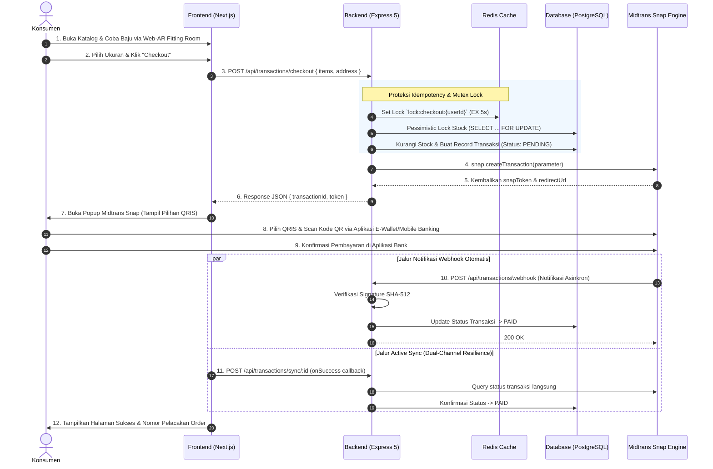
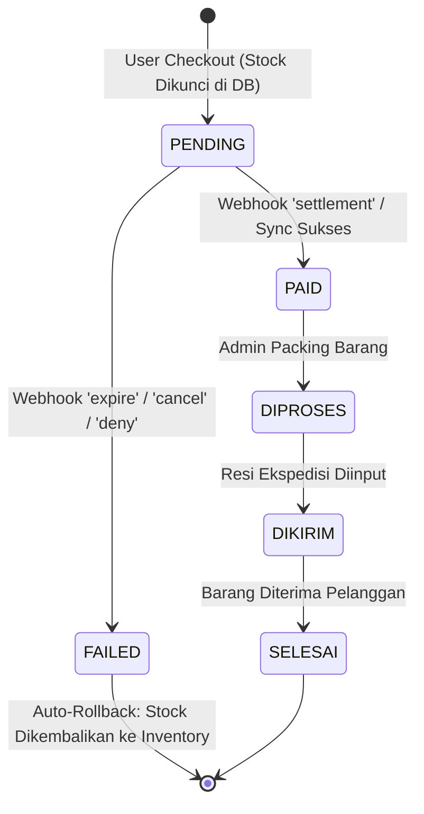

# PRD, Architecture, Flow & Business Model: Midtrans Standar (0.7%) QRIS Engine
## Phygital Store — Implementasi Sistem Pembayaran Digital Siap Pakai (Production-Ready)

**Dokumen Versi:** 1.0  
**Tanggal:** 11 Oktober 2026  
**Status:** Implementasi Aktif (Production Ready)  
**Target Platform:** Phygital Store (Website Next.js 16 + Express 5 Backend + PostgreSQL + Midtrans Snap)

---

## 1. Executive Summary & Keputusan Strategis

Berdasarkan pertimbangan operasional dan efisiensi waktu, integrasi pembayaran digital **Phygital Store** difokuskan secara penuh pada **QRIS Midtrans Standar (MDR 0.7% / Rp 1.400 per transaksi Rp 200.000)** yang **sudah 100% terpasang dan aktif di production codebase**.

Langkah pendaftaran NIB dan pengajuan kategori Usaha Mikro (UMI 0.3%) ditunda untuk menghilangkan friksi birokrasi, biaya legalitas awal, dan waktu tunggu. Sistem yang ada saat ini sudah memberikan efisiensi luar biasa:
* **Hanya memotong Rp 1.400 (0.7%)** dibandingkan dengan potongan marketplace Shopee sebesar **Rp 27.250 (13.6%)**.
* Mengamankan selisih kas riil sebesar **Rp 25.850 per potong baju** langsung ke rekening bank toko Anda.
* Menggunakan otomatisasi 100% (Webhook SHA-512, Redis Idempotency, dan Active Polling Sync) tanpa cek mutasi manual.

---

## 2. Business Model: Direct-to-Consumer (D2C) Phygital Commerce

### 2.1. Business Model Canvas (BMC)

```
┌───────────────────┬───────────────────┬───────────────────┬───────────────────┬───────────────────┐
│ Key Partners      │ Key Activities    │ Value             │ Customer          │ Customer          │
│                   │                   │ Propositions      │ Relationships     │ Segments          │
│ • Midtrans        │ • Kurasi & jahit  │ • Coba baju instan│ • Self-service AR │ • Urban Fashion & │
│   (Payment Gateway│   pakaian premium │   Web-AR tanpa app│   fitting 24/7    │   Streetwear      │
│ • Ekspedisi Logis-│ • Optimasi Web-AR │ • Zero-doubt size:│ • Pengiriman cepat│   Enthusiasts     │
│   tik (J&T, JNE)  │   Fitting Room    │   turunkan retur  │   bernotifikasi   │ • Pembeli cerdas  │
│ • Pabrik Tekstil  │ • Pengiriman aman │ • Checkout aman & │   realtime        │   yang peduli     │
│   Katun Grade-A   │   bersegel        │   instan via QRIS │ • Layanan CS WA   │   akurasi ukuran  │
├───────────────────┼───────────────────┤                   ├───────────────────┼───────────────────┤
│ Key Resources     │                   │                   │ Channels          │                   │
│ • Web-AR Engine   │                   │                   │ • Website D2C     │                   │
│ • Server Database │                   │                   │   (Kanal Utama)   │                   │
│   PostgreSQL+Redis│                   │                   │ • Toko Fisik/POS  │                   │
│ • Stok Baju Fisik │                   │                   │ • Shopee (Etalase │                   │
│ • Akun Midtrans   │                   │                   │   Akuisisi awal)  │                   │
├───────────────────┴───────────────────┴───────────────────┴───────────────────┴───────────────────┤
│ Cost Structure                                            │ Revenue Streams                       │
│ • HPP Bahan Baku: Rp 70.000 / pcs (35%)                   │ • Penjualan Retail Website: Rp 200.000│
│ • Midtrans Payment Gateway Fee: Rp 1.400 / pcs (0.7%)     │   (Laba Bersih Kotor: Rp 128.600/pcs) │
│ • Biaya Server Cloud & CDN: Flat bulanan terukur          │ • Penjualan In-Store POS: Tunai/QRIS  │
│ • Kemasan Kardus & Polymailer: Rp 3.500 / order           │ • Shopee Markup: Rp 215.000           │
└───────────────────────────────────────────────────────────┴───────────────────────────────────────┘
```

### 2.2. Kebijakan Finansial: Zero-Burn Rate & Non-Promo Rule
Sesuai arahan strategi keuangan, penghematan fee sebesar **Rp 25.850 per pcs** tidak dialokasikan untuk diskon atau voucher bakar duit, melainkan:
1. **Modal Kerja Bahan:** Membeli bahan baku berkualitas tanpa fasilitas pinjaman modal berbunga.
2. **Cadangan Kas Operasional:** Mengamankan *operating reserve* kas likuiditas.
3. **Infrastruktur & Web-AR:** Menjaga uptime sistem fitting virtual 99.9%.
4. **Proteksi Pengiriman:** Menggunakan kemasan kardus tebal dan *sealing tape* berkualitas tinggi.

---

## 3. User & Transaction Flow (End-to-End)

### 3.1. Customer Purchase & QRIS Payment Flow



### 3.2. State Machine Transaksi Pembayaran



---

## 4. Product Requirements Document (PRD)

### 4.1. Tujuan & Ruang Lingkup
Menyediakan pengalaman pembayaran instan tanpa hambatan (*frictionless*) melalui QRIS Midtrans Standar pada toko online D2C Phygital Store. Sistem menjamin keamanan transaksi tingkat perbankan, kebal terhadap kecurangan manipulasi harga (*price tampering*), dan sinkronisasi otomatis status pembayaran tanpa campur tangan staf manual.

### 4.2. Functional Requirements (FR)

| ID | Fitur | Kebutuhan Fungsional | Status Implementasi |
|:---|:---|:---|:---|
| **FR-1** | **Server-Side Price Validation** | Backend menghitung total harga murni dari database PostgreSQL. Harga kiriman `req.body.price` diabaikan sepenuhnya untuk mencegah manipulasi harga dari browser console. | ✅ Selesai (`transactionController.ts:77-80`) |
| **FR-2** | **Pessimistic Inventory Locking** | Eksekusi `SELECT stock FROM "Inventory" ... FOR UPDATE` saat checkout. Mencegah *race condition* dan *overselling* saat beberapa pembeli berebut ukuran pakaian yang sama secara bersamaan. | ✅ Selesai (`transactionController.ts:82`) |
| **FR-3** | **Integrated Midtrans Snap Popup** | Menampilkan modal popup Snap langsung di atas halaman checkout tanpa mengalihkan (*redirect*) konsumen keluar dari domain website, mempertahankan retensi pengguna. | ✅ Selesai (`layout.tsx:60-70`, `Header.tsx:68`) |
| **FR-4** | **QRIS Display Priority** | Snap menyajikan QRIS yang dapat di-scan oleh seluruh aplikasi perbankan (BCA, Mandiri, BRI, BNI) dan E-Wallet (GoPay, ShopeePay, Dana, OVO, LinkAja). | ✅ Selesai (Default Snap Engine) |
| **FR-5** | **Anti-Fake Webhook Verification** | Webhook wajib memvalidasi Signature Key `SHA-512(order_id + status_code + gross_amount + ServerKey)` sebelum memproses pembaruan status. | ✅ Selesai (`transactionController.ts:346-356`) |
| **FR-6** | **Dual-Channel Reconciliation (Active Sync)** | Menyediakan endpoint `/api/transactions/sync/:id` yang memanggil status Midtrans secara aktif jika webhook terhalang firewall/gangguan konektivitas. | ✅ Selesai (`transactionController.ts:427-480`) |
| **FR-7** | **Auto Stock Rollback** | Jika pembayaran kedaluwarsa (`expire`) atau dibatalkan (`cancel`), sistem secara otomatis mengembalikan jumlah stok ke inventaris produk. | ✅ Selesai (`transactionController.ts:400-415`) |

### 4.3. Non-Functional Requirements (NFR)

* **Keamanan:** Kunci server rahasia (`MIDTRANS_SERVER_KEY`) hanya tersimpan di lingkungan backend `.env` dan tidak pernah terekspos ke frontend.
* **Performa & Timeout:** Pemanggilan Snap API dilindungi *circuit-timeout* 8.000 ms. Thread server tidak akan hang jika server payment gateway mengalami kelambatan.
* **Idempotency:** Request beruntun dari pengguna yang sama dikunci selama 5 detik menggunakan Redis mutex (`lock:checkout:{userId}`).

---

## 5. System Architecture & Technical Specification

### 5.1. High-Level Component Architecture

```
┌─────────────────────────────────────────────────────────────────────────────┐
│                       PHYGITAL STORE ARCHITECTURE                           │
├─────────────────────────────────────────────────────────────────────────────┤
│                                                                             │
│  [CLIENT TIER]                                                              │
│  Next.js 16 (React 19) ──▶ MediaPipe Web-AR Try-On                         │
│       │               ──▶ Midtrans Snap.js Modal Script                    │
│       ▼                                                                     │
│  [API GATEWAY TIER]                                                         │
│  Express 5.2 Server    ──▶ Rate Limiter (express-rate-limit)                │
│       │                ──▶ Redis Distributed Mutex (NX: true, EX: 5)        │
│       ▼                                                                     │
│  [BUSINESS LOGIC TIER]                                                      │
│  Transaction Controller──▶ Pessimistic Row Lock (FOR UPDATE)                │
│       │                ──▶ SHA-512 Webhook Signature Validator             │
│       │                ──▶ Dual-Sync Midtrans Gateway Client                │
│       ▼                                                                     │
│  [PERSISTENCE TIER]                                                         │
│  PostgreSQL Database   ──▶ "Transaction", "TransactionItem", "Inventory"   │
│                                                                             │
│  [EXTERNAL SERVICES]                                                        │
│  Midtrans Core API     ──▶ QRIS Generation, Settlement, Webhook Callbacks  │
│                                                                             │
└─────────────────────────────────────────────────────────────────────────────┘
```

### 5.2. Spesifikasi Endpoint Transaksi

#### A. Inisiasi Checkout
* **Endpoint:** `POST /api/transactions/checkout`
* **Autentikasi:** Bearer JWT (Cookie HttpOnly)
* **Request Payload:**
```json
{
  "items": [
    { "productId": "prod_cm123xyz", "quantity": 1 }
  ],
  "shippingZone": "ZONE_JAWA_BALI",
  "recipientName": "Budi Santoso",
  "phoneNumber": "081234567890",
  "fullAddress": "Jl. Merdeka No. 45, Bojonegoro",
  "city": "Bojonegoro",
  "postalCode": "62111"
}
```
* **Response Payload (200 OK):**
```json
{
  "message": "Checkout berhasil",
  "transactionId": "tx_cl987abc123",
  "token": "76e3c809-51d8-4f51-b844-32b0e9c991b1",
  "paymentUrl": "https://app.midtrans.com/snap/v2/vtweb/76e3c809...",
  "subtotal": 200000,
  "shippingCost": 0,
  "totalAmount": 200000
}
```

#### B. Midtrans Webhook Notifier
* **Endpoint:** `POST /api/transactions/webhook`
* **Autentikasi:** Terbuka untuk IP Midtrans (Divalidasi via Hash SHA-512)
* **Payload:**
```json
{
  "order_id": "tx_cl987abc123",
  "status_code": "200",
  "gross_amount": "200000.00",
  "signature_key": "3a8b...sha512...f1c4",
  "transaction_status": "settlement",
  "payment_type": "qris"
}
```

#### C. Active Reconciliation Sync
* **Endpoint:** `POST /api/transactions/sync/:id`
* **Autentikasi:** Pemilik transaksi atau role `ADMIN`
* **Fungsi:** Mengambil data status langsung dari Midtrans Core API dan menyelaraskan status PostgreSQL secara seketika saat pembeli menutup modal QRIS.

---

## 6. Verifikasi Kesiapan Operasional & Peluncuran

Semua komponen berikut telah diverifikasi dan siap beroperasi di environment lokal/server:

1. **Midtrans Production Keys:** Terpasang di `backend/.env` dan `frontend/.env.local` (`Mid-server-...` & `Mid-client-...`).
2. **Koneksi Database:** Skema Prisma sinkron dengan tabel `Transaction`, `Inventory`, dan `OrderTracking`.
3. **Frontend Integration:** Tombol checkout di keranjang belanja memanggil popup pembayaran Midtrans Snap secara responsif di perangkat desktop maupun smartphone.
4. **Alur Finansial:** Setiap transaksi Rp 200.000 memotong Rp 1.400 (0.7%), menyetorkan Rp 198.600 bersih ke rekening kas toko Anda dalam H+1 hari kerja.
